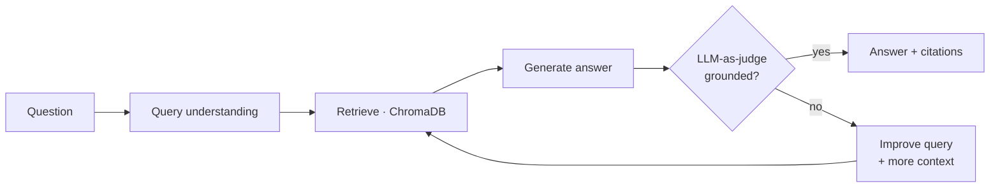

<div align="center">


<a href="https://sureshnarayananankumar.github.io/suresh-portfolio/">
  
</a>

<p>
  <a href="https://sureshnarayananankumar.github.io/suresh-portfolio/"></a>
  <a href="https://www.linkedin.com/in/suresh-kumar-n-bbb113253"></a>
  <a href="mailto:sureshnarayanan122@gmail.com"></a>
  <a href="https://sureshnarayananankumar.github.io/suresh-portfolio/Suresh_Kumar_Resume.pdf"></a>
</p>


</div>

---

## 👨‍💻 About me

```python
class SureshKumarN:
    role       = "Generative AI & Full Stack Software Engineer"
    company    = "Business Gateways International"
    experience = "3.5 years"
    impact     = "Gov. of Oman platforms · 18,900+ suppliers · 117 countries"
    focus      = ["LangGraph agents", "RAG pipelines", "LLM evaluation", "Full stack delivery"]
    languages  = ["English", "Tamil", "Hindi (basic)"]

    def open_to(self):
        return "GenAI · LLM · AI Full Stack roles | Chennai, Bangalore, Hyderabad, Pune or remote"
```

> 💬 **Try it live:** my [portfolio](https://sureshnarayananankumar.github.io/suresh-portfolio/) has an in-browser **AI copilot** you can interview, and a **JD fit analyser**. Paste a job description and get a match score.

## 📈 Impact at a glance

| | Result | Project |
|:-:|---|:-:|
| 🤖 | **−40%** manual review effort with LangGraph agentic workflows | RABT |
| 🔎 | **−50%** search time with RAG semantic search over 20K+ records | RABT |
| 📄 | **−67%** contract review time (30 min → 10 min) with LLM review | JSRS |
| ⚡ | **Lighthouse 65 → 90+** after a Next.js → Angular 22 SSR migration | RABT |
| 🚀 | **p95 < 300 ms** APIs, 3× faster dashboards, −35% latency with Redis | RABT · JSRS |

## 🛠️ Tech stack

<p align="center">
  <br/>
  <br/>
  
</p>

<p align="center">
  
  
  
  
  
  
  
  
  
  
  
  
  
  
</p>

## 🚀 Featured projects

<sub>👇 Click a project to expand it</sub>

<details>
<summary><b>🧠 DataOps AI Assistant</b> · Agentic RAG with self-checking answers</summary>
<br/>

Upload dbt, Snowflake, SQL and runbook docs, then ask questions. A LangGraph agent retrieves, answers, checks itself with an LLM judge and retries when an answer isn't grounded.



- Cites document, page, chunk and match score; says **"I don't know"** instead of guessing
- Offline eval suite: retrieval hit rate and groundedness
- **Stack:** Python · FastAPI · LangGraph · ChromaDB · React · Gemini / OpenAI

<a href="https://github.com/sureshnarayananankumar/dataops-ai-assistant"></a>
</details>

<details>
<summary><b>🧑‍💼 HR ATS</b> · Applicant tracking from requisition to onboarding</summary>
<br/>

- Multi-level requisition approvals and a public careers portal
- 12-stage Kanban hiring pipeline, interview scorecards and offer approvals
- 6 roles, 70 permissions, MFA, CSRF protection, rate limiting and audit logs
- **Stack:** React · NestJS · Prisma · MySQL · Redis · Docker

<a href="https://github.com/sureshnarayananankumar/hr-ats"></a>
</details>

<details>
<summary><b>📝 AssessHub</b> · Timed assessments with auto-grading</summary>
<br/>

- Question bank: MCQ, short and long answers, coding and file upload
- Server-timed attempts, autosave and tab-focus monitoring
- 55 JUnit/Mockito tests and 19 Vitest tests
- **Stack:** Java 21 · Spring Boot · React 18 · MySQL · Docker

<a href="https://github.com/sureshnarayananankumar/assessment-tracking"></a>
</details>

<details>
<summary><b>🌐 AI Portfolio</b> · Interview my AI copilot</summary>
<br/>

- In-browser RAG agent that answers recruiter questions with citations and a live agent trace
- JD fit analyser, GenAI lab demos and interactive architecture diagrams
- **Stack:** HTML · CSS · vanilla JavaScript · SVG

👉 **[Open the live portfolio](https://sureshnarayananankumar.github.io/suresh-portfolio/)**
</details>

<details>
<summary><b>🏛️ Production work</b> · Government of Oman platforms (RABT, JSRS, NSS)</summary>
<br/>

| Platform | What I built |
|---|---|
| **RABT** | LangGraph agents for certificate validation, RAG search over 20K+ records, RAGAS + LLM-as-judge evaluation, guardrails and LangSmith/Langfuse tracing; led a 1-week Next.js → Angular 22 SSR migration |
| **JSRS** | LLM contract review, document routing, Node.js/GraphQL microservices, MySQL indexing and Redis caching |
| **NSS** | Full stack subsidy platform with bilingual English/Arabic (RTL) UI and JWT/RBAC security |

</details>

## 📊 GitHub activity

<p align="center">
  
  
</p>
<p align="center">
  
</p>
<p align="center">
  
</p>

## 🏅 Certifications

- **Generative AI** · NASSCOM & MeitY (2026)
- **AI Full Stack Masterclass** · NoviTech R&D (2023)

<div align="center">

### 🤝 Let's build something with AI

<a href="mailto:sureshnarayanan122@gmail.com"></a>


</div>
