<div align="center">


<a href="https://sureshnarayananankumar.github.io/suresh-portfolio/">
  
</a>

<p align="center">
  <a href="#about"></a>
  <a href="#build"></a>
  <a href="#projects"></a>
  <a href="#copilot"></a>
  <a href="#contact"></a>
</p>

<p>
  <a href="https://sureshnarayananankumar.github.io/suresh-portfolio/"></a>
  <a href="https://www.linkedin.com/in/suresh-kumar-n-bbb113253"></a>
  <a href="mailto:sureshnarayanan122@gmail.com"></a>
  <a href="https://sureshnarayananankumar.github.io/suresh-portfolio/Suresh_Kumar_Resume.pdf"></a>
</p>


</div>

<p align="center"></p>

<h3 align="center">🧭 Choose your path</h3>
<p align="center">
  <a href="#recruiter" title="Availability, location, roles and a live demo"></a>
  <a href="#build" title="Agents, architecture and the full stack"></a>
  <a href="#play" title="Quiz, git log, easter egg and guestbook"></a>
</p>

<p align="center"></p>

<a name="about"></a>
## 👨‍💻 About me

<p align="center"></p>

<details>
<summary>🐍 <b>Prefer code?</b> Click to view me as a Python class</summary>
<br/>

```python
class SureshKumarN:
    role       = "Generative AI & Full Stack Software Engineer"
    company    = "Business Gateways International"
    experience = "3.5 years"
    impact     = "Gov. of Oman platforms · 18,900+ suppliers · 117 countries"
    focus      = ["LangGraph agents", "RAG pipelines", "LLM evaluation", "Full stack delivery"]
    languages  = ["English", "Tamil", "Hindi (basic)"]

    def open_to(self):
        return "GenAI · LLM · AI Full Stack roles | Chennai, Bangalore, Hyderabad, Pune or remote"
```
</details>

<p align="center"></p>

<a name="build"></a>
## ⚙️ What I build

<p align="center"></p>

<details>
<summary>🔍 <b>How does this agent work?</b> Click for the step-by-step</summary>
<br/>

1. **Router** classifies the request and sends it to the right sub-graph
2. **Hybrid retriever** combines vector and keyword search over 20K+ records, then a **reranker** keeps the top 3
3. **LLM validator** checks the certificate using tool calls
4. **Guardrail** blocks unfaithful answers; **RAGAS + LLM-as-judge** scores every run, traced in LangSmith/Langfuse
5. High confidence → **auto-approve**; low confidence → **human review**

Result: **−40% manual review effort** on the RABT platform.
</details>

<p align="center"></p>

### 🧱 Core stack

<p align="center"></p>

<details>
<summary>🔬 <b>Where I've used each one</b> · click to expand</summary>
<br/>

| Tech | Proof in production & projects |
|---|---|
| **Angular** | Led a Next.js → Angular 22 SSR/Signals migration on RABT in 1 week (12 routes, 47 components, Lighthouse 65 → 90+) |
| **React** | HR ATS and AssessHub front ends, DataOps AI dashboard; Redux state management |
| **Node.js** | REST + GraphQL APIs on RABT and JSRS (p95 < 300 ms); NestJS backend for HR ATS |
| **Spring Boot** | Microservices on Oman government platforms; AssessHub backend |
| **Java** | Java 21 services with 55 JUnit/Mockito tests (AssessHub) |
| **SQL · MySQL** | Schema design and indexing that made JSRS dashboards 3× faster; Prisma + MySQL on HR ATS |

</details>

> [!TIP]
> 🖱️ **Hover over any icon** to see where I used it.

<p align="center">
  
  
  
  
  
  
  
  
  
  
  
  
  
  
  
</p>

### 🪐 Tech universe

<p align="center"></p>

<details open>
<summary>🧰 <b>Full toolbox</b></summary>
<br/>

<p align="center">
  <br/>
  <br/>
  
</p>

<p align="center">
  
  
  
  
  
  
  
  
  
  
  
  
  
  
</p>

</details>

<p align="center"></p>

<a name="projects"></a>
## 🚀 Featured projects

<sub>👆 Every card is clickable</sub>

<table>
<tr>
<td width="50%"><a href="https://github.com/sureshnarayananankumar/dataops-ai-assistant"></a></td>
<td width="50%"><a href="https://github.com/sureshnarayananankumar/hr-ats">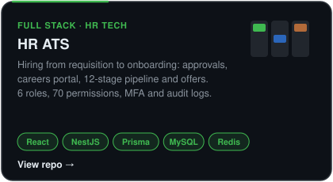</a></td>
</tr>
<tr>
<td width="50%"><a href="https://github.com/sureshnarayananankumar/assessment-tracking"></a></td>
<td width="50%"><a href="https://sureshnarayananankumar.github.io/suresh-portfolio/">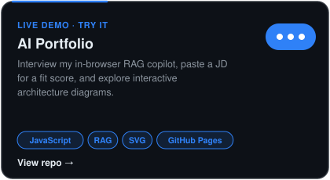</a></td>
</tr>
</table>

#### 🔎 Deep dives

<details>
<summary><b>🧠 DataOps AI Assistant</b> · Agentic RAG with self-checking answers</summary>
<br/>

Upload dbt, Snowflake, SQL and runbook docs, then ask questions. A LangGraph agent retrieves, answers, checks itself with an LLM judge and retries when an answer isn't grounded.

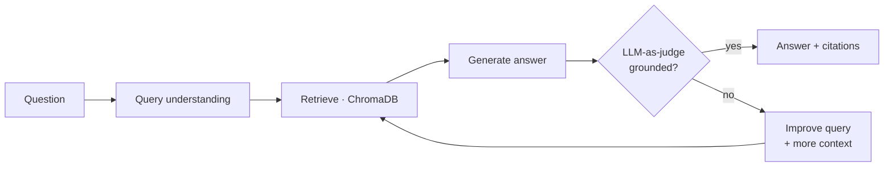

- Cites document, page, chunk and match score; says **"I don't know"** instead of guessing
- Offline eval suite: retrieval hit rate and groundedness
- **Stack:** Python · FastAPI · LangGraph · ChromaDB · React · Gemini / OpenAI

</details>

<details>
<summary><b>🏛️ Production work</b> · Government of Oman platforms (RABT, JSRS, NSS)</summary>
<br/>

| Platform | What I built |
|---|---|
| **RABT** | LangGraph agents for certificate validation, RAG search over 20K+ records, RAGAS + LLM-as-judge evaluation, guardrails and LangSmith/Langfuse tracing; led a 1-week Next.js → Angular 22 SSR migration |
| **JSRS** | LLM contract review, document routing, Node.js/GraphQL microservices, MySQL indexing and Redis caching |
| **NSS** | Full stack subsidy platform with bilingual English/Arabic (RTL) UI and JWT/RBAC security |

</details>

<p align="center"></p>

<a name="copilot"></a>
## 💬 Talk to my AI copilot

<p align="center"><a href="https://sureshnarayananankumar.github.io/suresh-portfolio/"></a></p>

<p align="center"><sub>👆 Click the chat to ask it your own questions on my portfolio</sub></p>

<p align="center"></p>

## 🧭 Career journey

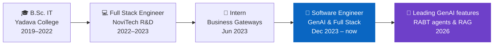

<a name="recruiter"></a>
## 🙋 Recruiter quick answers

<details><summary><b>Are you available to join?</b></summary><br/>Yes, I'm an <b>immediate joiner</b>.</details>
<details><summary><b>Where can you work?</b></summary><br/>Chennai, Bangalore, Hyderabad, Pune or remote. Onsite, hybrid or remote all work.</details>
<details><summary><b>What roles fit you best?</b></summary><br/>GenAI / LLM Engineer, AI Full Stack Engineer, and applied AI on regulated data (government, bilingual EN/AR).</details>
<details><summary><b>How do you evaluate LLM output?</b></summary><br/>RAGAS metrics, LLM-as-judge scoring, hallucination guardrails and tracing with LangSmith and Langfuse, plus offline test sets for retrieval hit rate and groundedness.</details>
<details><summary><b>Can I see a live demo?</b></summary><br/>Yes: <a href="https://sureshnarayananankumar.github.io/suresh-portfolio/">open my portfolio</a> and ask the AI copilot anything, or paste your JD into the fit analyser.</details>

<p align="center"></p>

<a name="play"></a>
## 🎮 Play & explore

### 🧠 Mini-game: how well do you know my work?

<sub>Pick an answer in your head, then click to reveal it.</sub>

<details>
<summary><b>Q1.</b> What made the JSRS dashboards 3× faster? &nbsp; <code>A) a CDN</code> <code>B) MySQL indexing</code> <code>C) a bigger server</code></summary>
<br/>✅ <b>B) MySQL indexing.</b> Load time went from 6 s to 2 s, and Redis caching cut cached API latency by another 35%.
</details>

<details>
<summary><b>Q2.</b> How long did the Next.js → Angular 22 SSR migration take? &nbsp; <code>A) 1 week</code> <code>B) 1 month</code> <code>C) 1 quarter</code></summary>
<br/>✅ <b>A) 1 week.</b> 12 routes, 47 components and 59 Vitest + Playwright tests, with Lighthouse up from 65 to 90+.
</details>

<details>
<summary><b>Q3.</b> My DataOps agent finds its answer isn't grounded. What does it do? &nbsp; <code>A) answers anyway</code> <code>B) retries, then says "I don't know"</code> <code>C) crashes</code></summary>
<br/>✅ <b>B).</b> It retries once with an improved query and more context. If the sources still don't support an answer, it says "I don't know" instead of guessing.
</details>

<details>
<summary><b>Q4.</b> How many suppliers use the platforms I build? &nbsp; <code>A) 1,500</code> <code>B) 7,000</code> <code>C) 18,900+</code></summary>
<br/>✅ <b>C) 18,900+ suppliers in 117 countries</b>, across Government of Oman platforms.<br/><br/>🏆 <b>4/4?</b> You'd make a great teammate. <a href="mailto:sureshnarayanan122@gmail.com">Let's talk.</a>
</details>

### 🌿 My career as a git log

<sub>Drag to pan, scroll to zoom.</sub>

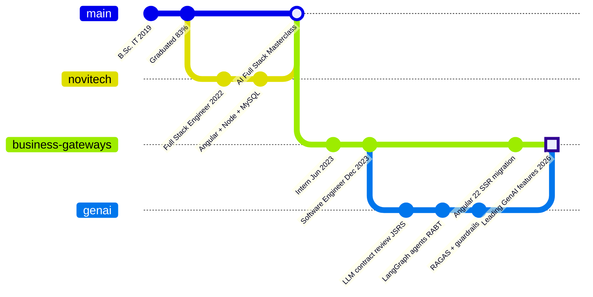

### 🗺️ Skill map

<details>
<summary>🧩 <b>Open the interactive mind map</b></summary>
<br/>

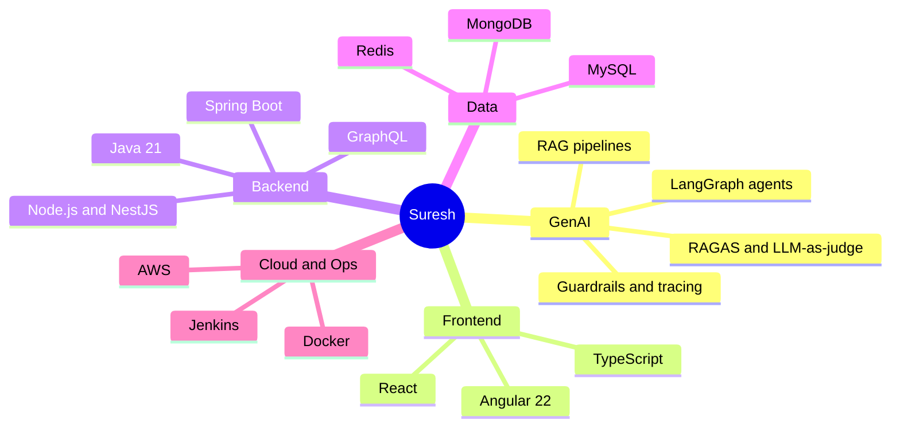
</details>

### 🥚 Easter egg

<details>
<summary>🚫 <b>Don't click this</b></summary>
<br/>
<details>
<summary>😅 You clicked it. Okay, but definitely <b>don't</b> click this one</summary>
<br/>
<details>
<summary>🤫 Last one, I promise…</summary>
<br/>

> 🎉 **You found the secret!** Fun fact: my portfolio's AI copilot runs **entirely in your browser**. No server, no API key, no data leaves your machine. [Go try to stump it →](https://sureshnarayananankumar.github.io/suresh-portfolio/)

</details>
</details>
</details>

### ✍️ Sign my guestbook

<p align="center">
  <a href="https://github.com/sureshnarayananankumar/sureshnarayananankumar/issues/new?title=%F0%9F%91%8B+Guestbook%3A+Hello+from+...&body=Name%3A%0AWhere+I%27m+from%3A%0AA+note+for+Suresh%3A%0A"></a>
  <a href="https://github.com/sureshnarayananankumar/sureshnarayananankumar/issues/new?title=%F0%9F%92%A1+Ask+me+anything%3A+...&body=My+question%3A%0A"></a>
</p>

<p align="center"></p>

## 🛰️ Mission control

<p align="center"><a href="https://sureshnarayananankumar.github.io/suresh-portfolio/" title="Open my live portfolio"></a></p>

<details>
<summary>📡 <b>Decode the radar</b> · click to see what each blip means</summary>
<br/>

| Blip | Signal |
|---|---|
| 🟣 **LangGraph · RAG** | Agentic workflows and semantic search in production on RABT |
| 🔴 **Angular** | Angular 22 SSR + Signals, migrated in 1 week |
| 🔵 **React** | Front ends for HR ATS, AssessHub and DataOps AI |
| 🟢 **Spring Boot · Node.js** | Microservices, REST and GraphQL APIs |
| 🔷 **MySQL** | Schema design and indexing for 3× faster dashboards |
| 🟠 **AWS** | Deployment and Bedrock for LLM workloads |

</details>

## 🏅 Certifications

- **Generative AI** · NASSCOM & MeitY (2026)
- **AI Full Stack Masterclass** · NoviTech R&D (2023)

<a name="contact"></a>
<div align="center">

### 🤝 Let's build something with AI

<a href="mailto:sureshnarayanan122@gmail.com"></a>


</div>
